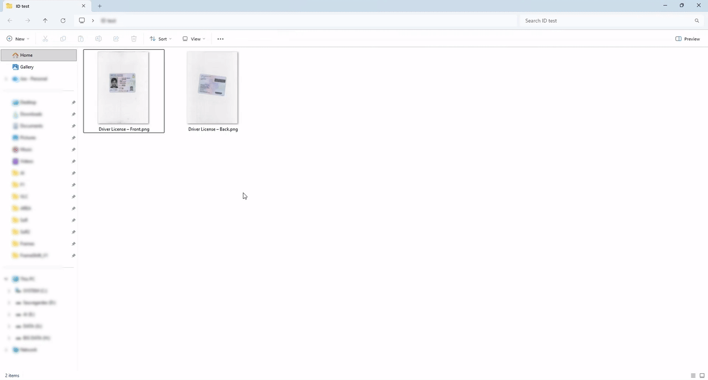
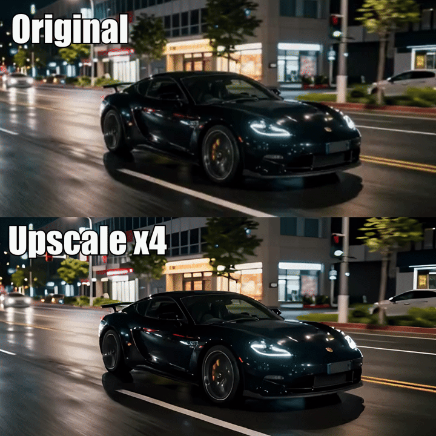

# FrameShift

🌐 [English](README.md) | [简体中文](README.zh-CN.md) | **Español** | [Português (Brasil)](README.pt-BR.md) | [Русский](README.ru.md)

**Herramienta gratuita y de código abierto para procesar video, audio, imágenes y PDF en Windows, con integración en el Explorador e IA local.**

La versión **1.22.0** está disponible en inglés, chino simplificado, español, portugués brasileño y ruso. La función Find Loop se reserva para la futura 1.23. Consulte las [notas de la 1.22.0](docs/RELEASE_NOTES_1.22.0.md) y el [informe de validación](docs/RELEASE_QUALIFICATION_1.22.0.md).

Gracias a [zhazhayu01](https://github.com/zhazhayu01) por la traducción al chino simplificado, el README chino y la corrección de la disposición en ventanas estrechas. Su [contribución original](https://github.com/zhazhayu01/FrameShift/commit/f078b0c3490ae43abba807bba24692df8ef446da) está integrada en la 1.22.0. La traducción al español parte de los recursos originales y utiliza el mismo catálogo de idiomas.

<p align="center">
  
</p>

## Contenido

- [Descarga](#descarga)
- [Qué ofrece FrameShift](#qué-ofrece-frameshift)
- [Uso rápido](#uso-rápido)
- [Idioma y apariencia](#idioma-y-apariencia)
- [Funciones](#funciones)
- [IA local y modelos](#ia-local-y-modelos)
- [Desarrollo](#desarrollo)
- [Compilar el instalador](#compilar-el-instalador)
- [Documentación](#documentación)
- [Preguntas frecuentes](#preguntas-frecuentes)

## Descarga

**[Descargar la última versión pública](https://github.com/Gaurox/FrameShift/releases/latest)**

Versión actual: **[1.22.0](https://github.com/Gaurox/FrameShift/releases/tag/v1.22.0)**. El instalador incluye los cinco idiomas.

FrameShift está pensado para **Windows 10 y Windows 11 de 64 bits**. El instalador es autónomo: incluye el entorno .NET, FFmpeg y FFprobe. El usuario final no necesita instalarlos por separado. Los modelos de IA se obtienen aparte, según la función utilizada.

Las versiones siguen el esquema `1.<versión de funciones>.<parche>`: las funciones nuevas incrementan el número central y los parches incrementan el último.

## Qué ofrece FrameShift

FrameShift permite iniciar tareas multimedia desde el menú contextual del Explorador o desde una ventana sencilla en la que se pueden arrastrar archivos. Ajuste los parámetros necesarios, revise una vista previa cuando esté disponible y guarde el resultado junto al archivo de origen.

- Procesamiento local: los archivos multimedia no se suben a ningún servidor.
- Archivos de salida con nombres únicos, sin sobrescribir los originales.
- Acciones disponibles según el tipo y la cantidad de archivos seleccionados.
- Colas y operaciones por lotes para trabajar con varios archivos.
- Vistas previas, controles de cancelación y detalles de progreso y errores.
- Interfaz WinForms ligera, con temas claro, oscuro y del sistema.

La 1.22.0 incorpora los cinco idiomas y correcciones generales de integridad, cancelación, memoria, importación de carpetas, descargas de modelos y comunicaciones locales. Los detalles y las comprobaciones pendientes se conservan en el informe de validación.

## Uso rápido

1. Abra FrameShift y arrastre archivos de video, audio, imágenes o PDF a la ventana, o utilice los controles para añadir archivos.
2. Seleccione los archivos que desea procesar y elija una acción compatible. Si no selecciona archivos concretos, la acción utiliza los archivos compatibles de la cola.
3. Ajuste los parámetros y utilice la vista previa cuando corresponda.
4. Inicie el procesamiento y busque el resultado en la carpeta del archivo de origen.

Después de configurar la integración con el Explorador mediante el instalador, también puede hacer clic derecho sobre un archivo y elegir una acción de FrameShift. Ejecutar el programa directamente durante el desarrollo no configura esos menús. La ventana principal permite añadir lotes grandes sin depender del límite de selección del menú contextual de Windows.

## Idioma y apariencia

El instalador de la 1.22.0 ofrece **English**, **简体中文**, **Español**, **Português Brasileiro** y **Русский**. El idioma elegido se utiliza en sus páginas, las descripciones de componentes y los menús opcionales del Explorador, y establece el idioma predeterminado de la aplicación.

En **Configuración → Idioma de la aplicación** puede guardar una preferencia personal. El cambio se aplica **al volver a iniciar FrameShift** y tiene prioridad sobre el idioma predeterminado del instalador. También actualiza automáticamente los menús instalados del Explorador. Windows solicita autorización de administrador para modificar los menús compartidos por todas las cuentas. Si cancela la autorización o falla la actualización, Configuración lo indica y conserva el idioma guardado para la aplicación.

La misma ventana permite cambiar el tema y elegir, abrir o restablecer la carpeta de modelos de IA. Las carpetas de modelos deben ser ubicaciones normales y dedicadas: no se permiten raíces de unidades, carpetas del sistema ni la carpeta de instalación.

## Funciones

### Video

| Acción | Descripción |
| --- | --- |
| Convertir video | Cambiar el contenedor y el perfil de códec con ajustes prácticos. |
| Comprimir video | Reducir el tamaño mediante perfiles de calidad o un tamaño de destino compatible. |
| Quitar audio | Crear una copia del video sin audio. |
| Extraer audio | Guardar la primera pista de audio como un archivo independiente. |
| Extraer fotogramas | Exportar todos los fotogramas, el primero, el último o los fotogramas clave. |
| Crear GIF | Convertir un intervalo del video en un GIF con vista previa. |
| Unir videos | Ordenar clips en una línea de tiempo y unirlos en una sola pista. |
| Añadir subtítulos | Añadir una pista seleccionable o incrustar subtítulos con el editor visual. |
| Cortar video | Seleccionar un intervalo con límites de fotogramas y tiempos. |
| Recortar video | Ajustar el encuadre con controles visuales, detección de bordes y zoom. |
| Girar / voltear video | Cambiar la orientación o reflejar el video. |
| Cambiar tamaño | Ajustar las dimensiones del video. |
| Cambiar velocidad | Acelerar o ralentizar la reproducción. |
| Interpolar video | Generar fotogramas para una reproducción más fluida. |
| Información del archivo | Consultar los metadatos técnicos. |

Unir videos utiliza copia directa solo cuando los flujos son compatibles. En los demás casos admitidos, normaliza clips SDR a MP4 H.264/AAC, conserva la proporción mediante márgenes y añade silencio cuando falta audio. La mezcla o normalización de HDR no está disponible en esta primera versión de esa función.

Los subtítulos se pueden exportar como SRT, ASS o proyecto de FrameShift con tiempos por palabra. Este último permite personalizar después fuentes, colores, posición y efectos al incrustarlos en un video.

### Audio

Conversión de formatos, corte preciso, reproducción invertida, compresión, cambio de tono y velocidad, reducción de ruido y separación de pistas mediante IA local.

### Imágenes y PDF

Conversión y compresión de imágenes, creación de iconos `.ico` con varios tamaños, recorte visual, detección automática de bordes, giro y volteo, cambio de tamaño y composición de imágenes en una página PDF con edición visual.

<p align="center">
  
</p>

### IA local

| Acción | Modelos o características |
| --- | --- |
| Quitar fondo | BiRefNet y modos opcionales BRIA aportados manualmente por el usuario. |
| Quitar objetos | Pintar una máscara y reconstruir el fondo con LaMa FP32 o LaMa 2025. |
| Ampliar imagen | Real-ESRGAN x4plus, Anime 6B o Swin2SR; escalas x2, x3, x4 o tamaño personalizado conservando la proporción. |
| Ampliar video | Real-ESRGAN General v3, AnimeVideo v3 o x4plus Quality; conserva los FPS y el audio cuando es compatible. |
| Reducir ruido | DeepFilterNet3 para audio o para la pista de audio de un video; el video se copia sin volver a codificar. |
| Separar audio | Extraer voz, batería, bajo, otras pistas o una mezcla instrumental con HTDemucs. |
| Interpolar video (RIFE) | Interpolación local para movimiento más fluido o cámara lenta. |
| Crear subtítulos | Whisper Base, Small o Large-v3 Turbo; procesamiento en un proceso separado para evitar conflictos de ONNX Runtime. |
| Extraer texto | PP-OCRv6 Small o Tiny para imágenes y PDF; salida TXT, JSON o PDF con búsqueda. |

El OCR permite seleccionar páginas PDF, reutilizar texto existente, ajustar la calidad de renderizado y agrupar texto en párrafos. Reduce la resolución de páginas demasiado grandes para respetar los límites de memoria e informa del ajuste.

<p align="center">
  
</p>

## IA local y modelos

El procesamiento multimedia se realiza en el equipo. Los modelos descargables se obtienen al usarlos por primera vez y se verifican mediante sumas de integridad. Una vez preparados, las operaciones correspondientes funcionan sin conexión. Los modelos no se incluyen en el instalador.

Las funciones compatibles utilizan DirectML para acelerar el procesamiento en GPU y recurren a CPU cuando corresponde. Los modelos de ampliación de imágenes y video se guardan en carpetas independientes y verificadas. La velocidad y el uso de recursos dependen del modelo y del equipo.

Los modos BRIA RMBG-2.0 equilibrado y de alta calidad requieren obtener el modelo manualmente desde la [página oficial de BRIA](https://huggingface.co/briaai/RMBG-2.0/tree/main) y colocarlo en la carpeta indicada. FrameShift no lo incluye, descarga ni redistribuye. Su licencia es **CC BY-NC 4.0, para uso no comercial**. Consulte también las [licencias y avisos de terceros](THIRD_PARTY_NOTICES.md) para los demás componentes y modelos.

## Desarrollo

La aplicación utiliza **C#, .NET 8 LTS, WinForms, FFmpeg y FFprobe**, con componentes de IA local basados en ONNX Runtime DirectML. No es una aplicación web ni requiere servicios en la nube para procesar archivos.

Instale **.NET SDK 8.0.427** en Windows. [global.json](global.json) fija esa versión; tener únicamente un SDK más reciente no la sustituye. Desde PowerShell, en la raíz del repositorio:

```powershell
dotnet --version
dotnet restore .\src\FrameShift\FrameShift.csproj --locked-mode
dotnet restore .\src\FrameShift.SubtitlesWorker\FrameShift.SubtitlesWorker.csproj --locked-mode
dotnet restore .\tests\FrameShift.Tests\FrameShift.Tests.csproj --locked-mode
dotnet test .\tests\FrameShift.Tests\FrameShift.Tests.csproj --no-restore
dotnet run --project .\src\FrameShift\FrameShift.csproj
```

`dotnet --version` debe indicar `8.0.427`. Estos comandos usan la configuración de desarrollo y no generan un instalador distribuible. La restauración de dependencias puede requerir acceso a los repositorios de paquetes configurados. La ejecución depende de las herramientas y los recursos nativos del proyecto.

Si no hay una preferencia guardada ni un archivo de idioma de instalación, el programa usa inglés. Elija Español en Configuración y vuelva a iniciarlo.

## Compilar el instalador

Las compilaciones Release utilizan ImageSharp 4 y requieren una licencia privada válida `sixlabors.lic`, indicada mediante `SixLaborsLicenseFile`. Los responsables deben comprobar su vigencia; no deben publicar la clave, incluirla en el instalador ni omitir la validación. Los usuarios finales no necesitan esa licencia de compilación.

La preparación actual utiliza **Inno Setup 6.7.1**. Los archivos chino, español, portugués brasileño y ruso del instalador se conservan en [`installer/Languages`](installer/Languages/README.md), con sus fuentes, créditos y licencia. No es necesario modificar la instalación del compilador para añadirlos.

El único comando oficial de compilación del instalador es:

```powershell
$env:SixLaborsLicenseFile = 'C:\carpeta-protegida\sixlabors.lic'
.\build_installer.ps1
```

Sustituya la ruta de ejemplo por la ubicación privada real. Si el script no encuentra el compilador, especifíquelo:

```powershell
.\build_installer.ps1 -IsccPath 'C:\Program Files (x86)\Inno Setup 6\ISCC.exe'
```

Este proceso comprueba las entradas y la versión, restaura dependencias bloqueadas, ejecuta las pruebas Release obligatorias, genera el programa autónomo `win-x64`, verifica el contenido y compila el instalador. Si falla una comprobación requerida, hay que resolver la causa. El comando no publica el instalador en GitHub ni lo instala automáticamente.

## Documentación

- [Notas de la 1.22.0](docs/RELEASE_NOTES_1.22.0.md) e [informe de validación](docs/RELEASE_QUALIFICATION_1.22.0.md).
- [Mantenimiento y adición de traducciones](docs/LOCALIZATION.md).
- [Separación de las versiones 1.22 y 1.23](docs/RELEASE_PLAN_1.22_1.23.md).
- [Guía de extracción de texto](docs/EXTRACT_TEXT.md).
- [Índice de documentación](docs/README.md) e [historial de cambios](docs/CHANGELOG.md).
- [README en inglés](README.md), con capturas y detalles históricos, y [README en chino](README.zh-CN.md).
- [Contribución original al chino de zhazhayu01](https://github.com/zhazhayu01/FrameShift/commit/f078b0c3490ae43abba807bba24692df8ef446da).
- [Licencia GPL-3.0](LICENSE) y [avisos de terceros](THIRD_PARTY_NOTICES.md).

La documentación histórica y las licencias conservan su idioma original. Este README no sustituye sus condiciones ni presenta comprobaciones pendientes como realizadas.

## Preguntas frecuentes

**¿Es gratuito y de código abierto?** Sí. Se distribuye bajo GNU GPL v3.0, sin suscripción ni período de prueba.

**¿Sube mis archivos a Internet?** No. El procesamiento se realiza localmente. Las descargas de modelos opcionales requieren conexión, pero no suben los archivos multimedia.

**¿Necesito instalar FFmpeg o .NET?** No para el instalador autónomo: incluye ambos, además de FFprobe.

**¿Puedo procesar varios archivos?** Sí, según los formatos y la cantidad de entradas que admita cada acción.

**¿Puede sobrescribir mis originales?** Las salidas se crean junto al origen con nombres únicos; se conservan los originales y los resultados existentes.

**¿Incluye Find Loop?** No en esta 1.22. El trabajo de esa función está reservado para la futura 1.23.
