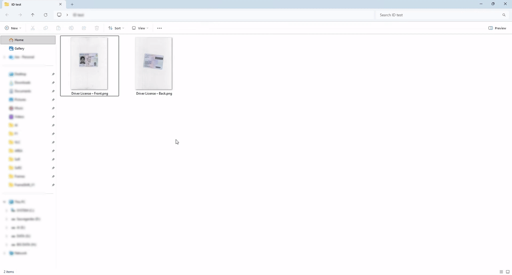

# FrameShift

🌐 [English](README.md) | [简体中文](README.zh-CN.md) | [Español](README.es.md) | [Português (Brasil)](README.pt-BR.md) | [Русский](README.ru.md) | **Français** | [日本語](README.ja.md) | [Bahasa Indonesia](README.id.md)

**Un utilitaire gratuit et open source pour traiter vidéos, fichiers audio, images et PDF sous Windows, depuis une fenêtre simple ou le menu contextuel de l’Explorateur, avec des fonctions d’IA locale.**

La **1.24.0** ajoute **Équilibrer le volume**, principalement pensé pour le visionnage de vidéos, ainsi que le français, le japonais et l’indonésien : FrameShift propose désormais **huit langues**. Le système de traduction facilite les contributions par CSV, et la langue choisie pendant une mise à jour s’applique aussi aux fenêtres lorsqu’une ancienne préférence était enregistrée. Voir les [notes de version](docs/RELEASE_NOTES_1.24.0.md) et le [rapport de validation](docs/RELEASE_QUALIFICATION_1.24.0.md).

L’installeur local **1.24.0** est validé par le propriétaire du projet et sa publication est en préparation. Le téléchargement public ci-dessous correspond à la **1.23.0**, qui a introduit **Trouver une boucle / Find Loop** dans Couper une vidéo et corrigé les actions masquées du menu vidéo classique de l’Explorateur.

<p align="center">
  
</p>

## Sommaire

- [Téléchargement](#téléchargement)
- [Utilisation rapide](#utilisation-rapide)
- [Équilibrer le volume](#équilibrer-le-volume)
- [Langues et traductions](#langues-et-traductions)
- [Fonctions](#fonctions)
- [IA locale et modèles](#ia-locale-et-modèles)
- [Développement](#développement)
- [Compiler l’installeur](#compiler-linstalleur)
- [Documentation](#documentation)

## Téléchargement

**[Télécharger la dernière version publique](https://github.com/Gaurox/FrameShift/releases/latest)**

Version publiée : **[1.23.0](https://github.com/Gaurox/FrameShift/releases/tag/v1.23.0)**. Les nouveautés et les huit langues décrites ici correspondent à la **1.24.0**, validée localement et en préparation de publication.

FrameShift fonctionne sous **Windows 10 et Windows 11, en 64 bits**. L’installeur autonome comprend .NET, FFmpeg et FFprobe : l’utilisateur n’a pas à les installer séparément. Les modèles d’IA sont obtenus à part, selon les fonctions utilisées.

## Utilisation rapide

1. Ouvrez FrameShift et glissez des vidéos, fichiers audio, images ou PDF dans la fenêtre, ou utilisez les boutons d’ajout.
2. Sélectionnez les fichiers à traiter et une action compatible. Sans sélection précise, l’action utilise les fichiers compatibles de la file.
3. Ajustez les paramètres et utilisez l’aperçu lorsqu’il est disponible.
4. Lancez le traitement : le résultat est enregistré à côté du fichier source, avec un nom unique qui préserve l’original et les résultats existants.

Après configuration de l’intégration par l’installeur, les actions sont également accessibles par clic droit dans l’Explorateur. La fenêtre principale permet d’ajouter des lots importants sans dépendre de la limite de sélection des menus Windows. Chaque action conserve ses propres règles de formats et de nombre de fichiers.

## Équilibrer le volume

Principalement pensée pour **regarder des films et d’autres vidéos**, cette fonction réduit les écarts entre les dialogues trop faibles et les scènes d’action ou musiques trop fortes. Elle aide à éviter les réglages constants du volume pendant le visionnage. Elle fonctionne aussi avec les fichiers audio seuls et traite l’ensemble du mixage, sur toutes les pistes audio.

- **Léger** : équilibrage doux qui conserve davantage de dynamique.
- **Modéré** : réglage sélectionné par défaut, pour une écoute courante.
- **Fort / Mode nuit** : équilibrage plus marqué pour une écoute à faible volume.

Le traitement est local, en **une seule passe FFmpeg**. Seul l’audio est réencodé : **la vidéo est copiée sans réencodage**. Les dispositions de canaux, sous-titres, chapitres et métadonnées sont conservés. L’action est disponible dans la fenêtre principale et les menus audio/vidéo de l’Explorateur, avec sa propre icône.

Consultez le [guide de la fonction](docs/BALANCE_VOLUME.md), en anglais, pour les formats et options de ligne de commande.

## Langues et traductions

La **1.24.0** propose les huit langues dans l’application, le worker de sous-titrage, l’installeur et les intitulés des menus de l’Explorateur :

**English · 简体中文 · Español · Português (Brasil) · Русский · Français · 日本語 · Bahasa Indonesia**

Le français, le japonais et l’indonésien sont nouveaux dans cette version.

La langue choisie pendant une installation, une mise à jour ou une réinstallation s’applique aux fenêtres **au prochain lancement**, une seule fois par utilisateur Windows. Une ancienne préférence ne bloque plus ce choix et les autres réglages sont conservés.

Vous pouvez ensuite choisir une autre langue dans **Paramètres → Langue de l’application**, puis relancer FrameShift. Les menus installés de l’Explorateur sont également mis à jour. Windows peut demander une autorisation administrateur pour les menus communs à tous les comptes ; leur modification concerne tous les utilisateurs. En cas d’annulation ou d’échec de mise à jour des menus, les paramètres affichent un message et la langue de l’application reste enregistrée.

**Contribuer à une traduction ne demande pas de programmer.** Un responsable fournit un CSV UTF-8 avec le texte anglais, son contexte et la traduction. Modifiez uniquement la colonne **Translation**, conservez les variables et les colonnes de référence, puis renvoyez le fichier. Les outils de maintenance fonctionnent hors ligne : export, contrôle, aperçu d’import, import avec sauvegardes et suivi des changements de textes.

Voir le [guide des contributeurs](docs/TRANSLATING.md), le [glossaire](docs/TRANSLATION_GLOSSARY.md) et le [processus de maintenance](docs/TRANSLATION_MAINTENANCE.md), en anglais. Le responsable se charge des contrôles et de l’intégration.

## Fonctions

### Vidéo

| Action | Description |
| --- | --- |
| Convertir une vidéo | Changer de format et de profil d’encodage. |
| Compresser une vidéo | Réduire la taille avec des profils de qualité ou une taille cible compatible. |
| Équilibrer le volume | Réduire les écarts de volume pendant le visionnage sans réencoder la vidéo. |
| Supprimer l’audio | Créer une copie de la vidéo sans son. |
| Extraire l’audio | Enregistrer la première piste audio dans un fichier séparé. |
| Extraire des images | Exporter toutes les images, la première, la dernière ou les images clés. |
| Créer un GIF | Transformer un passage vidéo en GIF avec aperçu. |
| Joindre des vidéos | Organiser des clips sur une ligne de temps puis les réunir. |
| Ajouter des sous-titres | Ajouter une piste sélectionnable ou incruster les sous-titres avec un éditeur visuel. |
| Couper une vidéo / Trouver une boucle | Choisir un passage, rechercher une boucle naturelle, prévisualiser la jonction ou créer un aller-retour. |
| Recadrer une vidéo | Ajuster le cadre avec un aperçu, la détection de bordures et le zoom. |
| Pivoter / Retourner | Corriger l’orientation ou appliquer un effet miroir. |
| Redimensionner | Modifier les dimensions de la vidéo. |
| Modifier la vitesse | Accélérer ou ralentir la lecture. |
| Interpoler une vidéo | Générer des images intermédiaires pour une lecture plus fluide. |
| Informations du média | Consulter les caractéristiques techniques du fichier. |

La jonction utilise une copie directe lorsque les flux sont strictement compatibles. Dans les autres cas pris en charge, les clips SDR sont normalisés en MP4 H.264/AAC, avec conservation des proportions par ajout de marges et de silence si nécessaire. Le mélange ou la normalisation HDR ne sont pas pris en charge dans cette première version de la fonction.

### Audio

Conversion, coupe précise, inversion, compression de la taille, équilibrage du volume, modification de la hauteur et de la vitesse, réduction du bruit et séparation des composantes avec l’IA locale.

### Images et PDF

Conversion et compression d’images, création d’icônes `.ico` à plusieurs tailles, recadrage visuel, détection de bordures, rotation et retournement, redimensionnement et composition d’images sur une page PDF.

<p align="center">
  
</p>

### IA locale

| Action | Modèles ou possibilités |
| --- | --- |
| Supprimer l’arrière-plan | Modes BiRefNet et modes BRIA facultatifs, fournis manuellement par l’utilisateur. |
| Supprimer un objet | Peindre un masque et reconstruire l’arrière-plan avec LaMa FP32 ou LaMa 2025. |
| Agrandir une image | Real-ESRGAN x4plus, Anime 6B ou Swin2SR ; ×2, ×3, ×4 ou dimensions personnalisées avec proportions conservées. |
| Agrandir une vidéo | Real-ESRGAN General v3, AnimeVideo v3 ou x4plus Quality ; conservation des FPS et de l’audio lorsque le format le permet. |
| Réduire le bruit | DeepFilterNet3 sur des fichiers audio ou la piste audio d’une vidéo, sans réencoder la vidéo. |
| Séparer l’audio | Extraire voix, batterie, basse, autres sons ou mixage instrumental avec HTDemucs. |
| Interpoler une vidéo (RIFE) | Générer des images intermédiaires pour une lecture plus fluide ou un ralenti. |
| Créer des sous-titres | Whisper Base, Small ou Large-v3 Turbo, dans un processus isolé. |
| Extraire du texte | PP-OCRv6 Small ou Tiny sur images et PDF ; export TXT, JSON ou PDF interrogeable. |

Les sous-titres peuvent être exportés en SRT, ASS ou projet FrameShift avec minutage par mot. L’OCR permet de choisir les pages PDF, réutiliser le texte existant, régler la qualité de rendu et regrouper les paragraphes. Les pages trop grandes sont rendues à une résolution adaptée aux limites de mémoire, avec indication de l’ajustement.

## IA locale et modèles

Les médias sont traités sur l’ordinateur. Les modèles téléchargeables sont récupérés à la première utilisation et vérifiés par empreinte d’intégrité. Une fois les modèles prêts, les traitements correspondants fonctionnent hors ligne. Les modèles ne sont pas inclus dans l’installeur.

Les fonctions compatibles utilisent le GPU via DirectML et disposent de replis sur CPU selon le modèle. Les modèles d’agrandissement d’images et de vidéos restent dans des dossiers distincts. La vitesse et les ressources nécessaires dépendent du matériel et du modèle.

Dans les paramètres, vous pouvez choisir, ouvrir ou rétablir le dossier des modèles et sélectionner le thème clair, sombre ou système. Le dossier des modèles doit être un dossier ordinaire et dédié ; les racines de disques, dossiers système et dossier d’installation ne conviennent pas.

Les modes BRIA RMBG-2.0 équilibré et haute qualité nécessitent d’obtenir vous-même le modèle depuis la [page officielle BRIA](https://huggingface.co/briaai/RMBG-2.0/tree/main), puis de le placer dans le dossier indiqué. FrameShift ne le fournit ni ne le télécharge. Consultez les [licences et avis des composants et modèles](THIRD_PARTY_NOTICES.md), notamment les conditions non commerciales CC BY-NC 4.0 de BRIA.

## Développement

Le projet utilise **C#, .NET 8 LTS, WinForms, FFmpeg et FFprobe**, avec ONNX Runtime DirectML pour l’IA locale. Le [SDK fixé par global.json](global.json) est **8.0.427**.

Depuis PowerShell, à la racine du dépôt :

```powershell
dotnet --version
dotnet restore .\src\FrameShift\FrameShift.csproj --locked-mode
dotnet restore .\src\FrameShift.SubtitlesWorker\FrameShift.SubtitlesWorker.csproj --locked-mode
dotnet restore .\tests\FrameShift.Tests\FrameShift.Tests.csproj --locked-mode
dotnet test .\tests\FrameShift.Tests\FrameShift.Tests.csproj --no-restore
dotnet run --project .\src\FrameShift\FrameShift.csproj
```

`dotnet --version` doit afficher `8.0.427`. Ces commandes utilisent la configuration de développement et ne produisent pas d’installeur distribuable. La restauration peut nécessiter un accès aux sources de paquets. Sans préférence ni langue d’installation, l’application utilise l’anglais ; choisissez Français dans les paramètres, puis relancez-la.

## Compiler l’installeur

Les compilations Release utilisent ImageSharp 4 et exigent une licence privée `sixlabors.lic` valide, fournie par `SixLaborsLicenseFile`. Les responsables doivent vérifier sa validité et respecter les [consignes de licence du README anglais](README.md#imagesharp-licence--maintainers-and-ai-agents). La clé ne doit être ni publiée, ni affichée, ni incluse dans l’installeur. L’utilisateur final n’a pas à fournir cette licence de compilation.

La préparation actuelle utilise **Inno Setup 6.7.1**. Les traductions de l’installeur sont conservées avec leurs sources, crédits et licence dans [`installer/Languages`](installer/Languages/README.md).

Le seul point d’entrée officiel pour fabriquer l’installeur est :

```powershell
$env:SixLaborsLicenseFile = 'C:\dossier-prive\sixlabors.lic'
.\build_installer.ps1
```

Remplacez le chemin d’exemple par le chemin privé réel. Si nécessaire, indiquez le compilateur avec `-IsccPath 'C:\Program Files (x86)\Inno Setup 6\ISCC.exe'`.

Le script vérifie les entrées et la version, restaure les dépendances verrouillées, exécute les tests Release obligatoires, publie le programme autonome `win-x64`, contrôle le paquet et ses traductions, puis compile l’installeur. Un échec doit être résolu avant de poursuivre. La commande ne publie pas le fichier sur GitHub et ne lance pas automatiquement l’installeur.

## Documentation

- [Notes de version 1.24.0](docs/RELEASE_NOTES_1.24.0.md) et [rapport de validation](docs/RELEASE_QUALIFICATION_1.24.0.md).
- [Équilibrer le volume](docs/BALANCE_VOLUME.md).
- [Guide de traduction](docs/TRANSLATING.md) et [maintenance des traductions](docs/TRANSLATION_MAINTENANCE.md).
- [Extraction de texte et PDF](docs/EXTRACT_TEXT.md).
- [Index documentaire](docs/README.md) et [historique des changements](docs/CHANGELOG.md).
- [README anglais](README.md), avec captures et informations historiques.
- [Licence GPL-3.0](LICENSE) et [avis de tiers](THIRD_PARTY_NOTICES.md).

Les documents techniques liés restent majoritairement en anglais. Les licences conservent leur texte d’origine.

Merci à [zhazhayu01](https://github.com/zhazhayu01) pour la traduction chinoise, le README chinois et la correction de la disposition en fenêtre étroite, intégrés depuis sa [contribution originale](https://github.com/zhazhayu01/FrameShift/commit/f078b0c3490ae43abba807bba24692df8ef446da).
