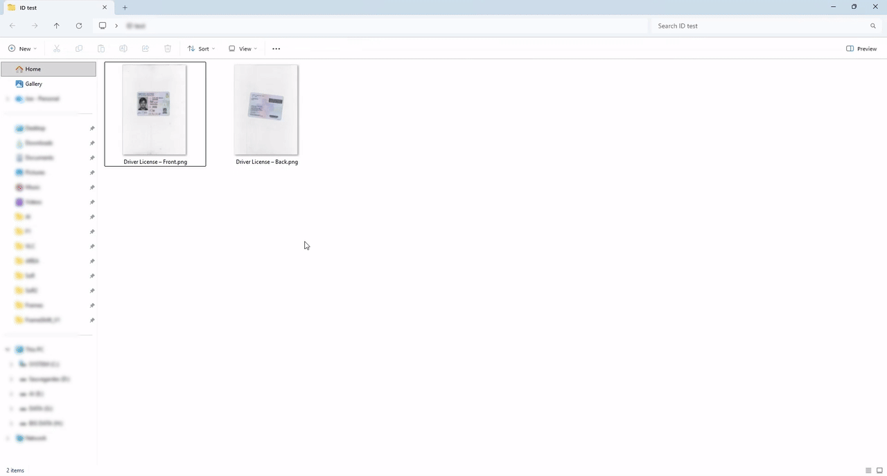

# FrameShift

🌐 [English](README.md) | [简体中文](README.zh-CN.md) | [Español](README.es.md) | [Português (Brasil)](README.pt-BR.md) | [Русский](README.ru.md) | [Français](README.fr.md) | [日本語](README.ja.md) | **Bahasa Indonesia**

**Utilitas gratis dan sumber terbuka untuk mengolah video, audio, gambar, dan PDF di Windows, melalui jendela sederhana atau menu klik kanan Explorer, dengan fitur AI lokal.**

Versi **1.24.0** menambahkan **Seimbangkan volume**, terutama untuk menonton video, serta bahasa Prancis, Jepang, dan Indonesia sehingga tersedia **delapan bahasa**. Kontribusi terjemahan menjadi lebih mudah melalui CSV. Bahasa yang dipilih saat pembaruan kini juga diterapkan ke jendela aplikasi meskipun preferensi bahasa lama masih tersimpan. Lihat [catatan rilis](docs/RELEASE_NOTES_1.24.0.md) dan [laporan validasi](docs/RELEASE_QUALIFICATION_1.24.0.md).

**[Versi 1.24.0 telah diterbitkan](https://github.com/Gaurox/FrameShift/releases/tag/v1.24.0)** dengan penginstal yang disetujui pemilik proyek. Versi **1.23.0** sebelumnya memperkenalkan **Cari loop / Find Loop** di Potong video dan memperbaiki tindakan yang tersembunyi pada menu video klasik Explorer.

<p align="center">
  
</p>

## Daftar isi

- [Unduh](#unduh)
- [Penggunaan cepat](#penggunaan-cepat)
- [Seimbangkan volume](#seimbangkan-volume)
- [Bahasa dan kontribusi terjemahan](#bahasa-dan-kontribusi-terjemahan)
- [Fitur](#fitur)
- [AI lokal dan model](#ai-lokal-dan-model)
- [Pengembangan](#pengembangan)
- [Membangun penginstal](#membangun-penginstal)
- [Dokumentasi](#dokumentasi)

## Unduh

**[Unduh rilis publik terbaru](https://github.com/Gaurox/FrameShift/releases/latest)**

Versi yang telah diterbitkan: **[1.24.0](https://github.com/Gaurox/FrameShift/releases/tag/v1.24.0)**. Penginstal menyertakan fitur baru dan delapan bahasa yang dijelaskan pada halaman ini.

FrameShift ditujukan untuk **Windows 10 dan Windows 11 64-bit**. Penginstal mandiri menyertakan .NET, FFmpeg, dan FFprobe sehingga pengguna tidak perlu memasangnya secara terpisah. Model AI diperoleh terpisah sesuai fitur yang digunakan.

## Penggunaan cepat

1. Buka FrameShift dan seret video, audio, gambar, atau PDF ke jendela, atau gunakan tombol untuk menambahkan berkas.
2. Pilih berkas yang akan diproses dan tindakan yang sesuai. Jika tidak ada berkas tertentu yang dipilih, tindakan menggunakan berkas yang sesuai dari antrean.
3. Sesuaikan pengaturan dan gunakan pratinjau bila tersedia.
4. Mulai pemrosesan. Hasil disimpan di sebelah sumber dengan nama unik, sehingga sumber dan hasil yang sudah ada tetap tersimpan.

Setelah integrasi Explorer diaktifkan melalui penginstal, tindakan juga tersedia lewat klik kanan pada berkas. Jendela utama dapat menerima kelompok berkas besar tanpa bergantung pada batas pilihan menu konteks Windows. Format dan jumlah masukan yang didukung tetap bergantung pada tiap tindakan.

## Seimbangkan volume

Fitur ini terutama dirancang untuk **menonton film dan video lainnya**. Perbedaan antara dialog yang terlalu pelan dan adegan aksi atau musik yang terlalu keras dikurangi, sehingga Anda tidak perlu terus mengubah volume saat menonton. Fitur ini juga dapat digunakan pada berkas audio tersendiri dan memproses seluruh campuran serta semua trek audio.

- **Ringan**: penyeimbangan lembut yang mempertahankan lebih banyak dinamika.
- **Sedang**: pilihan bawaan untuk mendengarkan sehari-hari.
- **Kuat / Mode malam**: penyeimbangan lebih kuat untuk mendengarkan pada volume rendah.

Pemrosesan berjalan secara lokal dalam **satu kali proses FFmpeg**. Hanya audio yang dikodekan ulang; **video disalin tanpa pengodean ulang**. Tata letak kanal, subtitel, bab, dan metadata dipertahankan. Tindakan tersedia di jendela utama dan menu audio/video Explorer, dengan ikon khusus.

Lihat [panduan fitur](docs/BALANCE_VOLUME.md) dalam bahasa Inggris untuk format dan opsi baris perintah.

## Bahasa dan kontribusi terjemahan

Versi **1.24.0** menyediakan delapan bahasa pada aplikasi, proses pekerja subtitel, penginstal, dan teks menu Explorer:

**English · 简体中文 · Español · Português (Brasil) · Русский · Français · 日本語 · Bahasa Indonesia**

Bahasa Prancis, Jepang, dan Indonesia baru ditambahkan pada versi ini.

Bahasa yang dipilih saat pemasangan, pembaruan, atau pemasangan ulang diterapkan ke jendela **pada peluncuran berikutnya**, sekali untuk setiap pengguna Windows. Pilihan baru tetap diterapkan meskipun ada preferensi bahasa lama. Pengaturan lainnya dipertahankan.

Setelah itu, Anda dapat memilih bahasa lain melalui **Pengaturan → Bahasa aplikasi**, lalu memulai ulang FrameShift. Menu Explorer yang terpasang juga diperbarui. Windows mungkin meminta izin administrator untuk mengubah menu yang digunakan bersama oleh semua akun; perubahan tersebut memengaruhi semua pengguna. Jika izin dibatalkan atau pembaruan menu gagal, Pengaturan menampilkan pesan dan bahasa aplikasi tetap tersimpan.

**Anda tidak perlu memprogram untuk berkontribusi menerjemahkan.** Pengelola memberikan CSV UTF-8 berisi sumber berbahasa Inggris, konteks, dan terjemahan. Ubah hanya kolom **Translation**, pertahankan variabel serta kolom referensi, simpan, lalu kembalikan berkas. Alat pemeliharaan lokal menyediakan ekspor, pemeriksaan, peninjauan perubahan, pratinjau impor, dan impor dengan cadangan.

Baca [panduan penerjemah](docs/TRANSLATING.md), [glosarium](docs/TRANSLATION_GLOSSARY.md), dan [alur pemeliharaan](docs/TRANSLATION_MAINTENANCE.md) dalam bahasa Inggris. Pengelola menangani pemeriksaan dan penerapan terjemahan ke proyek.

## Fitur

### Video

| Tindakan | Keterangan |
| --- | --- |
| Konversi video | Mengubah format dan profil pengodean. |
| Kompres video | Mengurangi ukuran dengan profil kualitas atau ukuran tujuan yang didukung. |
| Seimbangkan volume | Mengurangi perbedaan dialog pelan dan adegan keras tanpa mengodekan ulang video. |
| Hapus audio | Membuat salinan video tanpa suara. |
| Ekstrak audio | Menyimpan trek audio pertama sebagai berkas terpisah. |
| Ekstrak bingkai | Mengekspor semua bingkai, bingkai pertama, terakhir, atau bingkai kunci. |
| Buat GIF | Mengubah bagian video menjadi GIF dengan pratinjau. |
| Gabungkan video | Mengatur klip pada linimasa lalu menggabungkannya. |
| Tambahkan subtitel | Menambah trek yang dapat dipilih atau menyematkan subtitel ke gambar dengan editor visual. |
| Potong video / Cari loop | Memilih bagian, mencari loop alami, mempratinjau sambungan, atau membuat loop maju-mundur. |
| Pangkas video | Menyesuaikan area gambar dengan pratinjau, deteksi tepi, dan zoom. |
| Putar / Balik | Memperbaiki orientasi atau mencerminkan gambar. |
| Ubah ukuran | Mengubah dimensi video. |
| Ubah kecepatan | Mempercepat atau memperlambat pemutaran. |
| Interpolasi video | Menghasilkan bingkai perantara untuk gerakan yang lebih halus. |
| Info media | Melihat metadata teknis berkas. |

Penggabungan memakai penyalinan langsung hanya jika karakteristik aliran benar-benar cocok. Masukan SDR lain yang didukung dinormalisasi menjadi MP4 H.264/AAC, dengan margin untuk menjaga rasio aspek dan penambahan keheningan bila diperlukan. Pencampuran atau normalisasi HDR belum didukung pada versi awal fitur ini.

### Audio

Konversi format, pemotongan presisi, pemutaran terbalik, kompresi ukuran berkas, penyeimbangan volume, perubahan nada dan kecepatan, penghapusan derau, dan pemisahan komponen audio dengan AI lokal.

### Gambar dan PDF

Konversi dan kompresi gambar, pembuatan ikon `.ico` dalam beberapa ukuran, pemangkasan visual, deteksi tepi otomatis, putar dan balik, perubahan ukuran, serta penyusunan gambar pada halaman PDF.

<p align="center">
  
</p>

### AI lokal

| Tindakan | Model atau kemampuan |
| --- | --- |
| Hapus latar belakang | Mode BiRefNet dan mode BRIA opsional yang disediakan pengguna secara manual. |
| Hapus objek | Menggambar masker dan membangun ulang latar belakang dengan LaMa FP32 atau LaMa 2025. |
| Perbesar gambar | Real-ESRGAN x4plus, Anime 6B, atau Swin2SR; ×2 / ×3 / ×4 atau dimensi khusus dengan rasio aspek tetap. |
| Perbesar video | Real-ESRGAN General v3, AnimeVideo v3, atau x4plus Quality; mempertahankan FPS dan audio bila didukung. |
| Hapus derau | DeepFilterNet3 untuk audio atau trek audio video; video tidak dikodekan ulang. |
| Pisahkan audio | Mengekstrak vokal, drum, bas, komponen lain, atau campuran instrumental dengan HTDemucs. |
| Interpolasi video (RIFE) | Menghasilkan bingkai perantara untuk gerakan halus atau gerak lambat. |
| Buat subtitel | Whisper Base, Small, atau Large-v3 Turbo, dijalankan dalam proses pekerja terpisah. |
| Ekstrak teks | PP-OCRv6 Small atau Tiny pada gambar dan PDF; keluaran TXT, JSON, atau PDF yang dapat dicari. |

Subtitel dapat disimpan sebagai SRT, ASS, atau proyek FrameShift dengan waktu per kata. OCR menyediakan pilihan halaman PDF, penggunaan ulang teks yang sudah ada, kualitas perenderan, dan pengelompokan paragraf. Halaman yang terlalu besar dirender pada resolusi yang sesuai batas memori, disertai pemberitahuan penyesuaian.

## AI lokal dan model

Berkas media diproses di komputer dan tidak diunggah. Model yang dapat diunduh diperoleh saat pertama digunakan dan diverifikasi integritasnya. Setelah model siap, pemrosesan terkait dapat berjalan tanpa internet. Model tidak disertakan dalam penginstal.

Fitur yang mendukungnya memakai GPU melalui DirectML dan dapat beralih ke CPU sesuai model. Model pembesaran gambar dan video disimpan dalam folder terpisah. Kecepatan dan penggunaan sumber daya bergantung pada perangkat keras dan model.

Di Pengaturan, Anda dapat memilih tema terang, gelap, atau sistem, serta memilih, membuka, atau mengembalikan folder model AI ke bawaan. Gunakan folder biasa yang khusus untuk model; akar kandar, folder sistem, dan folder pemasangan tidak diperbolehkan.

Mode BRIA RMBG-2.0 seimbang dan kualitas tinggi mengharuskan pengguna memperoleh model sendiri dari [halaman resmi BRIA](https://huggingface.co/briaai/RMBG-2.0/tree/main), lalu meletakkannya di folder yang ditunjukkan. FrameShift tidak menyertakan, mengunduh otomatis, atau mendistribusikannya kembali. Lihat [lisensi dan pemberitahuan komponen serta model pihak ketiga](THIRD_PARTY_NOTICES.md), termasuk ketentuan nonkomersial CC BY-NC 4.0 dari BRIA.

## Pengembangan

Proyek menggunakan **C#, .NET 8 LTS, WinForms, FFmpeg, dan FFprobe**, dengan ONNX Runtime DirectML untuk AI lokal. [global.json](global.json) mengunci SDK ke **8.0.427**.

Dari PowerShell di akar repositori:

```powershell
dotnet --version
dotnet restore .\src\FrameShift\FrameShift.csproj --locked-mode
dotnet restore .\src\FrameShift.SubtitlesWorker\FrameShift.SubtitlesWorker.csproj --locked-mode
dotnet restore .\tests\FrameShift.Tests\FrameShift.Tests.csproj --locked-mode
dotnet test .\tests\FrameShift.Tests\FrameShift.Tests.csproj --no-restore
dotnet run --project .\src\FrameShift\FrameShift.csproj
```

`dotnet --version` harus menampilkan `8.0.427`. Perintah tersebut memakai konfigurasi pengembangan dan tidak membuat penginstal untuk distribusi. Pemulihan dependensi mungkin memerlukan akses ke sumber paket yang dikonfigurasi. Jika tidak ada preferensi atau bahasa pemasangan, aplikasi memakai bahasa Inggris. Pilih Bahasa Indonesia di Pengaturan, lalu mulai ulang.

## Membangun penginstal

Build Release memakai ImageSharp 4 dan membutuhkan lisensi privat `sixlabors.lic` yang masih berlaku, melalui `SixLaborsLicenseFile`. Pengelola harus memeriksa masa berlakunya dan mengikuti [petunjuk lisensi di README Inggris](README.md#imagesharp-licence--maintainers-and-ai-agents). Jangan menerbitkan kunci, menampilkannya dalam log, menyertakannya dalam penginstal, atau melewati validasi. Pengguna akhir tidak membutuhkan lisensi build tersebut.

Persiapan saat ini memakai **Inno Setup 6.7.1**. Terjemahan penginstal disimpan beserta sumber, kredit penerjemah, dan lisensinya di [`installer/Languages`](installer/Languages/README.md).

Satu-satunya perintah resmi untuk membuat penginstal adalah:

```powershell
$env:SixLaborsLicenseFile = 'C:\folder-privat\sixlabors.lic'
.\build_installer.ps1
```

Ganti contoh jalur dengan lokasi privat yang sebenarnya. Bila diperlukan, tentukan kompiler dengan `-IsccPath 'C:\Program Files (x86)\Inno Setup 6\ISCC.exe'`.

Skrip memeriksa masukan dan versi, memulihkan dependensi terkunci, menjalankan pengujian Release wajib, menerbitkan paket mandiri `win-x64`, memeriksa isi serta terjemahannya, lalu mengompilasi penginstal. Kegagalan pemeriksaan wajib harus diselesaikan. Perintah ini tidak menerbitkan berkas ke GitHub atau menjalankan penginstal secara otomatis.

## Dokumentasi

- [Catatan rilis 1.24.0](docs/RELEASE_NOTES_1.24.0.md) dan [laporan validasi](docs/RELEASE_QUALIFICATION_1.24.0.md).
- [Seimbangkan volume](docs/BALANCE_VOLUME.md).
- [Panduan penerjemah](docs/TRANSLATING.md) dan [pemeliharaan terjemahan](docs/TRANSLATION_MAINTENANCE.md).
- [Ekstraksi teks dan PDF](docs/EXTRACT_TEXT.md).
- [Indeks dokumentasi](docs/README.md) dan [riwayat perubahan](docs/CHANGELOG.md).
- [README Inggris](README.md), dengan tangkapan layar dan informasi versi terdahulu.
- [Lisensi GPL-3.0](LICENSE) dan [pemberitahuan pihak ketiga](THIRD_PARTY_NOTICES.md).

Dokumen teknis yang ditautkan sebagian besar berbahasa Inggris. Dokumen lisensi mempertahankan bahasa aslinya.

Terima kasih kepada [zhazhayu01](https://github.com/zhazhayu01) untuk terjemahan dan README Tionghoa Sederhana serta perbaikan tata letak jendela sempit, yang diintegrasikan dari [kontribusi aslinya](https://github.com/zhazhayu01/FrameShift/commit/f078b0c3490ae43abba807bba24692df8ef446da).
