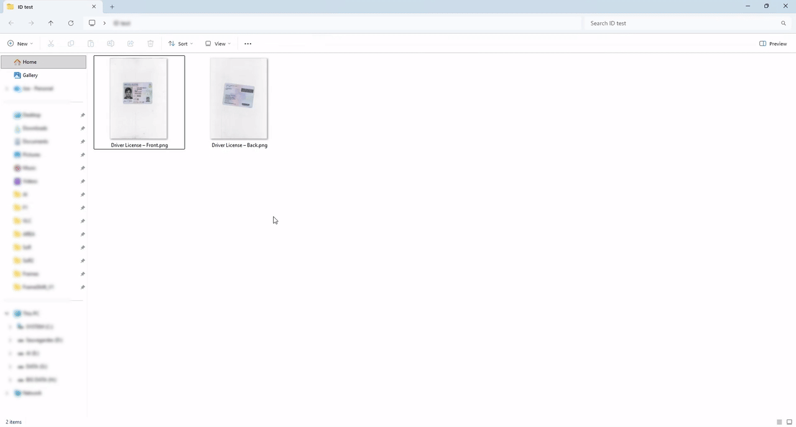
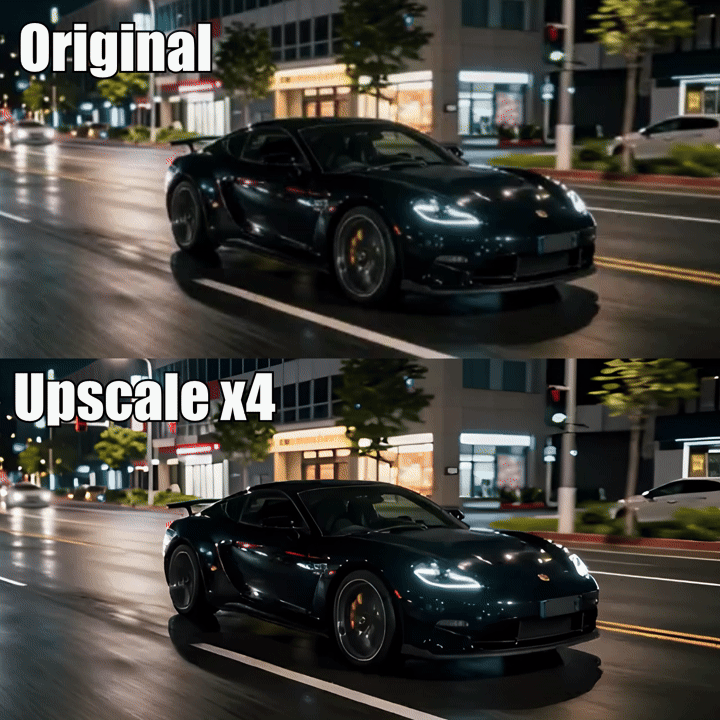

# FrameShift

🌐 [English](README.md) | [简体中文](README.zh-CN.md) | [Español](README.es.md) | **Português (Brasil)** | [Русский](README.ru.md)

**Ferramenta gratuita e de código aberto para processar vídeos, áudios, imagens e PDFs no Windows, com integração ao Explorador e IA local.**

A versão pública continua sendo a **1.21.1**. Esta ramificação prepara a **1.22.0 em inglês, chinês simplificado, espanhol, português brasileiro e russo**, ainda **não publicada**. O recurso Find Loop fica reservado para a futura 1.23. Consulte as [notas da 1.22.0](docs/RELEASE_NOTES_1.22.0.md) e o [relatório de validação](docs/RELEASE_QUALIFICATION_1.22.0.md).

Agradecemos a [zhazhayu01](https://github.com/zhazhayu01) pela tradução para chinês simplificado, pelo README chinês e pela correção da disposição em janelas estreitas. Sua [contribuição original](https://github.com/zhazhayu01/FrameShift/commit/f078b0c3490ae43abba807bba24692df8ef446da) está integrada nesta preparação. A tradução para português brasileiro parte dos recursos originais e usa o mesmo catálogo de idiomas.

<p align="center">
  
</p>

## Conteúdo

- [Download](#download)
- [O que o FrameShift oferece](#o-que-o-frameshift-oferece)
- [Uso rápido](#uso-rápido)
- [Idioma e aparência](#idioma-e-aparência)
- [Recursos](#recursos)
- [IA local e modelos](#ia-local-e-modelos)
- [Desenvolvimento](#desenvolvimento)
- [Compilar o instalador](#compilar-o-instalador)
- [Documentação](#documentação)
- [Perguntas frequentes](#perguntas-frequentes)

## Download

**[Baixar a versão pública mais recente](https://github.com/Gaurox/FrameShift/releases/latest)**

A versão pública **[1.21.1](https://github.com/Gaurox/FrameShift/releases/tag/1.21.1)** ainda não inclui as alterações de idioma desta ramificação. O instalador da 1.22.0 é preparado e verificado localmente antes da publicação.

O FrameShift foi desenvolvido para **Windows 10 e Windows 11 de 64 bits**. O instalador é autocontido: inclui o ambiente .NET, FFmpeg e FFprobe. O usuário final não precisa instalá-los separadamente. Os modelos de IA são obtidos à parte, conforme o recurso utilizado.

As versões seguem o esquema `1.<versão de recursos>.<correção>`: novos recursos incrementam o número central e correções incrementam o último.

## O que o FrameShift oferece

O FrameShift permite iniciar tarefas de mídia pelo menu de contexto do Explorador ou por uma janela simples na qual você pode soltar arquivos. Ajuste os parâmetros necessários, confira uma prévia quando disponível e salve o resultado ao lado do arquivo de origem.

- Processamento local: seus arquivos de mídia não são enviados para servidores.
- Arquivos de saída com nomes únicos, preservando os originais e os resultados existentes.
- Conversão, compressão, corte, recorte, redimensionamento e ferramentas práticas de mídia.
- Processamento de vários arquivos nas ações que aceitam lotes, com fila, progresso e cancelamento.
- Modelos de IA locais para tarefas como remoção de fundo, aumento de resolução, legendas e OCR.
- Interface WinForms leve, temas claro e escuro e integração opcional ao Explorador.

A 1.22.0 reúne os cinco idiomas e correções gerais de integridade, cancelamento, memória, importação de pastas, downloads de modelos e comunicação local. Os detalhes e as verificações pendentes estão no relatório de validação.

## Uso rápido

1. Abra o FrameShift e solte vídeos, áudios, imagens ou PDFs na janela, ou use os controles para adicionar arquivos.
2. Selecione os arquivos que deseja processar e escolha uma ação compatível. Sem uma seleção específica, a ação usa os arquivos compatíveis da fila.
3. Ajuste os parâmetros e use a prévia quando disponível.
4. Inicie o processamento e encontre o resultado na pasta do arquivo de origem.

Depois de configurar a integração ao Explorador pelo instalador, você também pode clicar com o botão direito em um arquivo e escolher uma ação do FrameShift. Executar diretamente o programa durante o desenvolvimento não configura esses menus. A janela principal permite adicionar lotes grandes sem depender do limite de seleção do menu de contexto do Windows.

## Idioma e aparência

O instalador da 1.22.0 oferece **English**, **简体中文**, **Español**, **Português Brasileiro** e **Русский**. O idioma escolhido é usado nas páginas do instalador, nas descrições dos componentes e nos menus opcionais do Explorador, além de definir o idioma padrão do aplicativo.

Em **Configurações → Idioma do aplicativo**, você pode salvar uma preferência pessoal. Escolha **Português (Brasil)** para usar esta tradução (`pt-BR`). A mudança é aplicada **na próxima inicialização do FrameShift** e tem prioridade sobre o idioma padrão do instalador. Ela também atualiza automaticamente os menus instalados do Explorador. O Windows solicita autorização de administrador para alterar os menus compartilhados por todas as contas. Se a autorização for cancelada ou a atualização falhar, Configurações informa o problema e mantém o idioma salvo para o aplicativo.

A mesma janela permite alterar o tema e escolher, abrir ou restaurar a pasta de modelos de IA. Escolha uma pasta comum e exclusiva para os modelos; raízes de unidades, pastas do sistema e a pasta de instalação não são permitidas.

## Recursos

### Vídeo

| Ação | Descrição |
| --- | --- |
| Converter vídeo | Alterar o contêiner e o perfil de codec com opções práticas. |
| Comprimir vídeo | Reduzir o tamanho com perfis de qualidade ou um tamanho de destino compatível. |
| Remover áudio | Criar uma cópia do vídeo sem áudio. |
| Extrair áudio | Salvar a primeira faixa de áudio em um arquivo separado. |
| Extrair quadros | Exportar todos os quadros, o primeiro, o último ou os quadros-chave. |
| Criar GIF | Converter um trecho do vídeo em GIF com prévia. |
| Unir vídeos | Organizar clipes na linha do tempo e uni-los em uma única faixa. |
| Adicionar legendas | Adicionar uma faixa selecionável ou gravar legendas na imagem com o editor visual. |
| Cortar vídeo | Selecionar um intervalo com limites de quadros e tempos. |
| Recortar vídeo | Ajustar o enquadramento com controles visuais, detecção de bordas e zoom. |
| Girar / espelhar vídeo | Alterar a orientação ou espelhar o vídeo. |
| Redimensionar vídeo | Ajustar as dimensões do vídeo. |
| Alterar velocidade | Acelerar ou desacelerar a reprodução. |
| Interpolar vídeo | Gerar quadros para uma reprodução mais fluida. |
| Informações da mídia | Consultar os metadados técnicos. |

Unir vídeos usa cópia direta apenas quando os fluxos são compatíveis. Nos demais casos aceitos, normaliza clipes SDR para MP4 H.264/AAC, preserva a proporção com margens e adiciona silêncio quando falta áudio. A mistura ou normalização de HDR não está disponível nesta primeira versão do recurso.

As legendas podem ser exportadas como SRT, ASS ou projeto do FrameShift com tempos por palavra. O projeto permite personalizar fontes, cores, posição e efeitos posteriormente, ao gravar legendas em um vídeo.

### Áudio

Conversão de formatos, corte preciso, reprodução invertida, compressão, alteração de tom e velocidade, remoção de ruído e separação de faixas com IA local.

### Imagens e PDF

Conversão e compressão de imagens, criação de ícones `.ico` com vários tamanhos, recorte visual, detecção automática de bordas, giro e espelhamento, redimensionamento e composição de imagens em uma página PDF com edição visual.

<p align="center">
  
</p>

### IA local

| Ação | Modelos ou características |
| --- | --- |
| Remover fundo | BiRefNet e modos opcionais BRIA fornecidos manualmente pelo usuário. |
| Remover objeto | Pintar uma máscara e reconstruir o fundo com LaMa FP32 ou LaMa 2025. |
| Aumentar resolução da imagem | Real-ESRGAN x4plus, Anime 6B ou Swin2SR; escalas x2, x3, x4 ou tamanho personalizado com a proporção preservada. |
| Aumentar resolução do vídeo | Real-ESRGAN General v3, AnimeVideo v3 ou x4plus Quality; mantém o FPS e o áudio quando compatível. |
| Remover ruído | DeepFilterNet3 para áudio ou para a faixa de áudio de um vídeo; o vídeo é copiado sem recodificar. |
| Separar áudio | Extrair voz, bateria, baixo, outras faixas ou uma mistura instrumental com HTDemucs. |
| Interpolar vídeo (RIFE) | Interpolação local para movimento mais fluido ou câmera lenta. |
| Criar legendas | Whisper Base, Small ou Large-v3 Turbo; execução em um processo separado para evitar conflitos do ONNX Runtime. |
| Extrair texto | PP-OCRv6 Small ou Tiny para imagens e PDFs; saída TXT, JSON ou PDF pesquisável. |

O OCR permite selecionar páginas PDF, reutilizar texto existente, ajustar a qualidade de renderização e agrupar o texto em parágrafos. Ele reduz a resolução de páginas grandes demais para respeitar os limites de memória e informa o ajuste.

<p align="center">
  
</p>

## IA local e modelos

O processamento de mídia ocorre no computador. Os modelos disponíveis para download são obtidos no primeiro uso e verificados com somas de integridade. Depois de preparados, os recursos correspondentes funcionam sem conexão. Os modelos não são incluídos no instalador.

Os recursos compatíveis usam DirectML para acelerar o processamento na GPU e recorrem à CPU quando aplicável. Os modelos de aumento de resolução de imagens e vídeos são armazenados em pastas separadas e verificadas. A velocidade e o uso de recursos dependem do modelo e do computador.

Os modos BRIA RMBG-2.0 equilibrado e de alta qualidade exigem obter o modelo manualmente na [página oficial da BRIA](https://huggingface.co/briaai/RMBG-2.0/tree/main) e colocá-lo na pasta indicada. O FrameShift não o inclui, baixa ou redistribui. Sua licença é **CC BY-NC 4.0, para uso não comercial**. Consulte também as [licenças e os avisos de terceiros](THIRD_PARTY_NOTICES.md) para os demais componentes e modelos.

## Desenvolvimento

O aplicativo usa **C#, .NET 8 LTS, WinForms, FFmpeg e FFprobe**, com componentes de IA local baseados no ONNX Runtime DirectML. O processamento de arquivos não exige serviços na nuvem.

Instale o **.NET SDK 8.0.425** no Windows. O [global.json](global.json) fixa essa versão; ter apenas um SDK mais recente não a substitui. No PowerShell, a partir da raiz do repositório:

```powershell
dotnet --version
dotnet restore .\src\FrameShift\FrameShift.csproj --locked-mode
dotnet restore .\src\FrameShift.SubtitlesWorker\FrameShift.SubtitlesWorker.csproj --locked-mode
dotnet restore .\tests\FrameShift.Tests\FrameShift.Tests.csproj --locked-mode
dotnet test .\tests\FrameShift.Tests\FrameShift.Tests.csproj --no-restore
dotnet run --project .\src\FrameShift\FrameShift.csproj
```

`dotnet --version` deve indicar `8.0.425`. Esses comandos usam a configuração de desenvolvimento e não geram um instalador distribuível. A restauração das dependências pode exigir acesso às fontes de pacotes configuradas. A execução depende das ferramentas e dos recursos nativos do projeto.

Sem uma preferência salva nem um arquivo de idioma de instalação, o programa usa inglês. Escolha Português (Brasil) em Configurações e reinicie o aplicativo.

## Compilar o instalador

As compilações Release usam ImageSharp 4 e exigem uma licença privada válida `sixlabors.lic`, indicada por `SixLaborsLicenseFile`. Os responsáveis devem verificar sua validade; a chave não deve ser publicada nem incluída no instalador, e a validação não deve ser ignorada. Os usuários finais não precisam dessa licença de compilação.

A preparação atual usa **Inno Setup 6.7.1**. Os arquivos de idioma chinês, espanhol, português brasileiro e russo do instalador são mantidos em [`installer/Languages`](installer/Languages/README.md), com fontes, créditos e licença. Não é necessário modificar a instalação do compilador para adicioná-los.

O único comando oficial para compilar o instalador é:

```powershell
$env:SixLaborsLicenseFile = 'C:\pasta-protegida\sixlabors.lic'
.\build_installer.ps1
```

Substitua o caminho de exemplo pelo local privado real. Se o script não encontrar o compilador, informe-o:

```powershell
.\build_installer.ps1 -IsccPath 'C:\Program Files (x86)\Inno Setup 6\ISCC.exe'
```

Esse processo verifica as entradas e a versão, restaura as dependências bloqueadas, executa os testes Release obrigatórios, gera o aplicativo autocontido `win-x64`, verifica o conteúdo e compila o instalador. Se uma verificação obrigatória falhar, resolva a causa. O comando não publica o instalador no GitHub nem o instala automaticamente.

## Documentação

- [Notas da 1.22.0](docs/RELEASE_NOTES_1.22.0.md) e [relatório de validação](docs/RELEASE_QUALIFICATION_1.22.0.md).
- [Manutenção e inclusão de traduções](docs/LOCALIZATION.md).
- [Separação das versões 1.22 e 1.23](docs/RELEASE_PLAN_1.22_1.23.md).
- [Guia de extração de texto](docs/EXTRACT_TEXT.md).
- [Índice da documentação](docs/README.md) e [histórico de alterações](docs/CHANGELOG.md).
- [README em inglês](README.md), [em chinês](README.zh-CN.md) e [em espanhol](README.es.md).
- [Contribuição original em chinês de zhazhayu01](https://github.com/zhazhayu01/FrameShift/commit/f078b0c3490ae43abba807bba24692df8ef446da).
- [Licença GPL-3.0](LICENSE) e [avisos de terceiros](THIRD_PARTY_NOTICES.md).

A documentação histórica e as licenças mantêm seu idioma original. Este README não substitui os termos das licenças nem apresenta verificações pendentes como concluídas.

## Perguntas frequentes

**É gratuito e de código aberto?** Sim. É distribuído sob a GNU GPL v3.0, sem assinatura ou período de avaliação.

**Meus arquivos são enviados para a internet?** Não. O processamento é local. Os downloads dos modelos opcionais exigem conexão, mas não enviam seus arquivos de mídia.

**Preciso instalar FFmpeg ou .NET?** Não ao usar o instalador autocontido: ele inclui ambos, além do FFprobe.

**Posso processar vários arquivos?** Sim, conforme os formatos e a quantidade de entradas aceitos por cada ação.

**O programa pode sobrescrever meus originais?** As saídas são criadas ao lado da origem com nomes únicos; os originais e os resultados existentes são preservados.

**Inclui Find Loop?** Não nesta 1.22. O trabalho desse recurso fica reservado para a futura 1.23.
