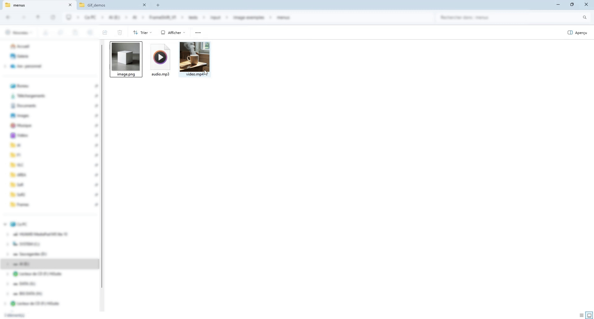
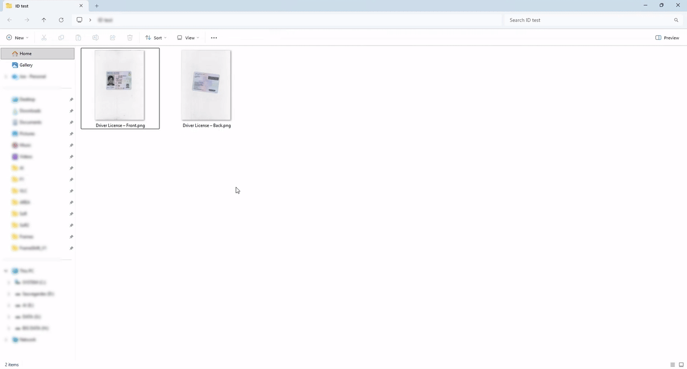
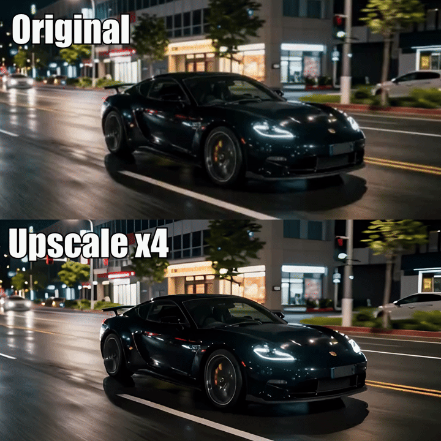

# FrameShift

🌐 [English](README.md) | [简体中文](README.zh-CN.md) | [Español](README.es.md) | [Português (Brasil)](README.pt-BR.md) | **Русский**

**Бесплатная программа с открытым исходным кодом для обработки видео, аудио, изображений и PDF в Windows, с интеграцией в Проводник и локальным ИИ.**

Опубликованная версия по-прежнему **1.21.1**. В этой ветке готовится **1.22.0 на английском, упрощённом китайском, испанском, бразильском португальском и русском языках**, пока **без публикации**. Функция Find Loop отложена до будущей версии 1.23. См. [примечания к 1.22.0](docs/RELEASE_NOTES_1.22.0.md) и [отчёт о проверке](docs/RELEASE_QUALIFICATION_1.22.0.md).

Спасибо [zhazhayu01](https://github.com/zhazhayu01) за перевод на упрощённый китайский, китайский README и исправление расположения элементов в узких окнах. Его [исходный вклад](https://github.com/zhazhayu01/FrameShift/commit/f078b0c3490ae43abba807bba24692df8ef446da) включён в эту подготовку. Русский перевод основан на исходных ресурсах и использует тот же каталог языков.

<p align="center">
  
</p>

## Содержание

- [Загрузка](#загрузка)
- [Возможности FrameShift](#возможности-frameshift)
- [Быстрый старт](#быстрый-старт)
- [Язык и оформление](#язык-и-оформление)
- [Функции](#функции)
- [Локальный ИИ и модели](#локальный-ии-и-модели)
- [Разработка](#разработка)
- [Сборка установщика](#сборка-установщика)
- [Документация](#документация)
- [Частые вопросы](#частые-вопросы)

## Загрузка

**[Загрузить последнюю опубликованную версию](https://github.com/Gaurox/FrameShift/releases/latest)**

Опубликованная **[1.21.1](https://github.com/Gaurox/FrameShift/releases/tag/1.21.1)** ещё не содержит языковых изменений этой ветки. Установщик 1.22.0 собирается и проверяется локально перед публикацией.

FrameShift предназначен для **64-разрядных Windows 10 и Windows 11**. Установщик самодостаточен: включает среду выполнения .NET, FFmpeg и FFprobe. Конечному пользователю не нужно устанавливать их отдельно. Модели ИИ загружаются отдельно в зависимости от используемой функции.

Номера версий имеют вид `1.<версия функций>.<исправление>`: новые функции увеличивают среднее число, а исправления — последнее.

## Возможности FrameShift

FrameShift позволяет запускать задачи обработки медиафайлов из контекстного меню Проводника или из простого окна с перетаскиванием файлов. Настройте нужные параметры, проверьте предпросмотр, если он доступен, и сохраните результат рядом с исходным файлом.

- Локальная обработка: медиафайлы не отправляются на серверы.
- Уникальные имена результатов с сохранением оригиналов и существующих файлов.
- Преобразование форматов, сжатие, обрезка по времени, кадрирование, изменение размеров и другие практичные инструменты.
- Пакетная обработка в поддерживающих её действиях, очередь, прогресс и отмена.
- Локальные модели ИИ для удаления фона, повышения разрешения, создания субтитров, OCR и других задач.
- Лёгкий интерфейс WinForms, светлая и тёмная темы и необязательная интеграция в Проводник.

В 1.22.0 включены пять языков и общие исправления целостности данных, отмены, использования памяти, импорта папок, загрузки моделей и локального взаимодействия процессов. Подробности и оставшиеся проверки перечислены в отчёте о проверке.

## Быстрый старт

1. Откройте FrameShift и перетащите в окно видео, аудио, изображения или PDF либо используйте кнопки добавления файлов.
2. Выберите файлы для обработки и совместимое действие. Если отдельные файлы не выделены, действие использует совместимые файлы из очереди.
3. Настройте параметры и используйте предпросмотр, если он предусмотрен.
4. Запустите обработку. Результат появится в папке исходного файла.

После настройки интеграции через установщик можно также нажать правой кнопкой мыши на файл и выбрать действие FrameShift. Прямой запуск программы при разработке не настраивает эти меню. Главное окно позволяет добавлять большие пакеты файлов без ограничения выделения контекстного меню Windows.

## Язык и оформление

Установщик 1.22.0 предлагает **English**, **简体中文**, **Español**, **Português Brasileiro** и **Русский**. Выбранный язык используется на страницах установки, в описаниях компонентов и необязательных меню Проводника, а также задаёт язык приложения по умолчанию.

В **Настройки → Язык приложения** можно сохранить личный выбор. Выберите **Русский** для использования этого перевода (`ru`). Варианты вроде `ru-RU` используют тот же перевод. Изменение применяется **при следующем запуске FrameShift** и имеет приоритет над языком установщика. При этом установленные меню Проводника обновляются автоматически. Для изменения меню, общих для всех учётных записей, Windows запрашивает разрешение администратора. При отмене разрешения или ошибке обновления в настройках появляется сообщение, а выбранный язык приложения сохраняется.

В том же окне можно сменить тему и выбрать, открыть или восстановить папку моделей ИИ. Используйте обычную отдельную папку для моделей; корни дисков, системные папки и папка установки не допускаются.

## Функции

### Видео

| Действие | Описание |
| --- | --- |
| Преобразовать видео | Изменить контейнер и профиль кодека с практичными настройками. |
| Сжать видео | Уменьшить размер с помощью профилей качества или поддерживаемого целевого размера файла. |
| Удалить аудио | Создать копию видео без аудио. |
| Извлечь аудио | Сохранить первую аудиодорожку в отдельный файл. |
| Извлечь кадры | Экспортировать все кадры, первый, последний или ключевые кадры. |
| Создать GIF | Преобразовать фрагмент видео в GIF с предпросмотром. |
| Объединить видео | Расположить фрагменты на шкале времени и объединить в одну дорожку. |
| Добавить субтитры | Добавить выбираемую дорожку или встроить субтитры в изображение с помощью визуального редактора. |
| Обрезать видео | Выбрать временной фрагмент по кадрам и времени. |
| Кадрировать видео | Изменить область изображения с визуальными настройками, определением границ и масштабированием. |
| Повернуть / отразить видео | Изменить ориентацию или зеркально отразить видео. |
| Изменить размер видео | Настроить ширину и высоту видео. |
| Изменить скорость | Ускорить или замедлить воспроизведение. |
| Интерполировать видео | Создать дополнительные кадры для более плавного воспроизведения. |
| Сведения о медиафайле | Просмотреть технические метаданные. |

Объединение использует прямое копирование только при совместимых потоках. В остальных поддерживаемых случаях фрагменты SDR нормализуются в MP4 H.264/AAC, пропорции сохраняются добавлением полей, а при отсутствии аудио добавляется тишина. Смешивание и нормализация HDR не поддерживаются в этой первой версии функции.

Субтитры можно экспортировать в SRT, ASS или проект FrameShift с временем каждого слова. Проект позволяет позднее настроить шрифты, цвета, положение и эффекты при встраивании субтитров в видео.

### Аудио

Преобразование форматов, точная обрезка, обратное воспроизведение, сжатие, изменение высоты тона и скорости, удаление шума и разделение дорожек с помощью локального ИИ.

### Изображения и PDF

Преобразование и сжатие изображений, создание значков `.ico` с несколькими размерами, визуальное кадрирование, автоматическое определение границ, поворот и отражение, изменение размеров и размещение изображений на одной странице PDF в визуальном редакторе.

<p align="center">
  
</p>

### Локальный ИИ

| Действие | Модели или особенности |
| --- | --- |
| Удалить фон | BiRefNet и дополнительные режимы BRIA с ручной установкой модели пользователем. |
| Удалить объект | Нарисовать маску и восстановить фон с LaMa FP32 или LaMa 2025. |
| Повысить разрешение изображения | Real-ESRGAN x4plus, Anime 6B или Swin2SR; x2, x3, x4 или свой размер с сохранением пропорций. |
| Повысить разрешение видео | Real-ESRGAN General v3, AnimeVideo v3 или x4plus Quality; сохранение FPS и аудио, когда поддерживается. |
| Удалить шум | DeepFilterNet3 для аудио или аудиодорожки видео; видео копируется без перекодирования. |
| Разделить аудио | Извлечь вокал, ударные, бас, прочие дорожки или инструментальную смесь с HTDemucs. |
| Интерполировать видео (RIFE) | Локальная интерполяция для более плавного движения или замедления. |
| Создать субтитры | Whisper Base, Small или Large-v3 Turbo; отдельный процесс помогает избежать конфликтов ONNX Runtime. |
| Извлечь текст | PP-OCRv6 Small или Tiny для изображений и PDF; результат TXT, JSON или PDF с поиском по тексту. |

OCR позволяет выбирать страницы PDF, повторно использовать существующий текст, настраивать качество отрисовки и объединять текст в абзацы. Разрешение слишком больших страниц уменьшается для соблюдения лимитов памяти; программа сообщает об этом изменении.

<p align="center">
  
</p>

## Локальный ИИ и модели

Медиафайлы обрабатываются на компьютере. Доступные для загрузки модели получаются при первом использовании и проверяются по контрольным суммам. После подготовки соответствующие функции работают без подключения к сети. Модели не входят в установщик.

Поддерживаемые функции используют DirectML для ускорения на GPU и переходят на CPU, когда это предусмотрено. Модели повышения разрешения изображений и видео хранятся в отдельных проверяемых папках. Скорость и расход ресурсов зависят от модели и компьютера.

Для сбалансированного и высококачественного режимов BRIA RMBG-2.0 нужно вручную получить модель с [официальной страницы BRIA](https://huggingface.co/briaai/RMBG-2.0/tree/main) и поместить её в указанную папку. FrameShift не включает, не загружает и не распространяет её. Лицензия — **CC BY-NC 4.0, для некоммерческого использования**. Условия других компонентов и моделей приведены в [лицензиях и уведомлениях сторонних разработчиков](THIRD_PARTY_NOTICES.md).

## Разработка

Приложение использует **C#, .NET 8 LTS, WinForms, FFmpeg и FFprobe**, а локальный ИИ основан на ONNX Runtime DirectML. Для обработки файлов не требуются облачные сервисы.

Установите **.NET SDK 8.0.425** в Windows. Версия зафиксирована в [global.json](global.json); одного более нового SDK недостаточно. Из корня репозитория в PowerShell:

```powershell
dotnet --version
dotnet restore .\src\FrameShift\FrameShift.csproj --locked-mode
dotnet restore .\src\FrameShift.SubtitlesWorker\FrameShift.SubtitlesWorker.csproj --locked-mode
dotnet restore .\tests\FrameShift.Tests\FrameShift.Tests.csproj --locked-mode
dotnet test .\tests\FrameShift.Tests\FrameShift.Tests.csproj --no-restore
dotnet run --project .\src\FrameShift\FrameShift.csproj
```

`dotnet --version` должен показывать `8.0.425`. Эти команды используют конфигурацию разработки и не создают установщик для распространения. Восстановление зависимостей может требовать доступа к настроенным источникам пакетов. Для запуска необходимы инструменты и нативные ресурсы проекта.

Если нет сохранённой настройки и файла языка установки, программа использует английский. Выберите «Русский» в настройках и перезапустите приложение.

## Сборка установщика

Сборки Release используют ImageSharp 4 и требуют действительную частную лицензию `sixlabors.lic`, путь к которой задаётся в `SixLaborsLicenseFile`. Ответственные за сборку должны проверить её действительность; нельзя публиковать ключ, включать его в установщик или пропускать проверку. Конечным пользователям эта лицензия сборки не требуется.

Текущая подготовка использует **Inno Setup 6.7.1**. Китайский, испанский, бразильский португальский и русский файлы языка установщика хранятся в [`installer/Languages`](installer/Languages/README.md) с указанием источников, авторов и лицензии. Для их использования не нужно изменять установленный компилятор.

Единственная официальная команда сборки установщика:

```powershell
$env:SixLaborsLicenseFile = 'C:\защищённая-папка\sixlabors.lic'
.\build_installer.ps1
```

Замените пример на настоящий закрытый путь. Если скрипт не находит компилятор, укажите его явно:

```powershell
.\build_installer.ps1 -IsccPath 'C:\Program Files (x86)\Inno Setup 6\ISCC.exe'
```

Процесс проверяет входные данные и версию, восстанавливает зафиксированные зависимости, запускает обязательные тесты Release, создаёт самодостаточную сборку `win-x64`, проверяет содержимое и компилирует установщик. Если обязательная проверка не проходит, нужно устранить причину. Команда не публикует установщик на GitHub и не запускает его автоматически.

## Документация

- [Примечания к 1.22.0](docs/RELEASE_NOTES_1.22.0.md) и [отчёт о проверке](docs/RELEASE_QUALIFICATION_1.22.0.md).
- [Поддержка и добавление переводов](docs/LOCALIZATION.md).
- [Разделение версий 1.22 и 1.23](docs/RELEASE_PLAN_1.22_1.23.md).
- [Руководство по извлечению текста](docs/EXTRACT_TEXT.md).
- [Указатель документации](docs/README.md) и [история изменений](docs/CHANGELOG.md).
- [README на английском](README.md), [китайском](README.zh-CN.md), [испанском](README.es.md) и [бразильском португальском](README.pt-BR.md).
- [Исходный вклад zhazhayu01 в китайский перевод](https://github.com/zhazhayu01/FrameShift/commit/f078b0c3490ae43abba807bba24692df8ef446da).
- [Лицензия GPL-3.0](LICENSE) и [уведомления сторонних разработчиков](THIRD_PARTY_NOTICES.md).

Историческая документация и тексты лицензий сохраняют исходный язык. Этот README не заменяет условия лицензий и не представляет незавершённые проверки как выполненные.

## Частые вопросы

**Программа бесплатная и с открытым кодом?** Да. Она распространяется по GNU GPL v3.0, без подписки и пробного периода.

**Мои файлы отправляются в интернет?** Нет. Обработка локальная. Для загрузки дополнительных моделей нужен интернет, но медиафайлы при этом не отправляются.

**Нужно устанавливать FFmpeg или .NET?** Нет, если использовать самодостаточный установщик: он включает оба компонента, а также FFprobe.

**Можно обработать несколько файлов?** Да, если выбранное действие поддерживает их форматы и количество входных файлов.

**Могут ли оригиналы быть перезаписаны?** Результаты создаются рядом с источником под уникальными именами; оригиналы и существующие результаты сохраняются.

**Есть ли Find Loop?** Не в этой 1.22. Работа над этой функцией сохранена для будущей 1.23.
